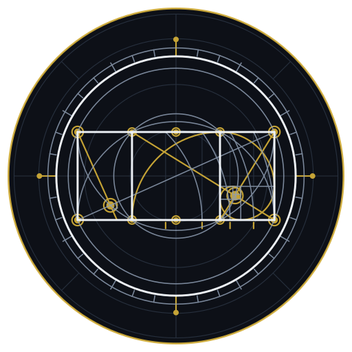

:site_title: Jay Hambidge

.. container:: author-overline

   semantic digital archive • the works of

============
Jay Hambidge
============

**Jay Hambidge** (1867–1924) rediscovered the proportional grammar of *Dynamic Symmetry*, showing how root rectangles (:math:`\sqrt{2}, \sqrt{3}, \sqrt{4}, \sqrt{5}`), orthogonal reciprocals, and the rectangle of the whirling squares unite Greek vase and temple design with the phyllotaxis of living plants. Rather than measuring shapes by linear fractions, Hambidge illuminated the ancient insight of commensurability in square. This digital archive presents his foundational 1919–1920 *Diagonal* lessons and *Greek Vase* synthesis in a synchronized three-track edition with calibrated vector figures.

Books in This Collection
------------------------

.. container:: home-book-hero

   .. container:: home-book-thumb

      .. image:: _static/figures/fig_golden_gnomon_spiral.svg
         :alt: Whirling-square golden gnomon spiral and Euclid IV.10 golden triangle
         :target: dynamic_symmetry/index.html

   .. container:: home-book-body

      .. rubric:: Yale University Press · 1919–1920 · 4 Parts · 3 Synchronized Tracks

      **The Elements of Dynamic Symmetry** — Hambidge's landmark lessons from *The Diagonal* and *Dynamic Symmetry: The Greek Vase*, tracing the contrast between static and dynamic symmetry, sunflower phyllotaxis, the root-five and whirling-square rectangles, and area-commensurable partitioning.

      .. container:: home-actions

         * :doc:`Open Dynamic Symmetry → <dynamic_symmetry/index>`
         * :doc:`Static & Dynamic Symmetry → <dynamic_symmetry/static_and_dynamic/static_and_dynamic-en>`
         * :doc:`The Whirling Squares → <dynamic_symmetry/whirling_squares/whirling_squares-en>`

Key Features
------------

.. container:: home-feature-grid

   .. container:: home-feature-card

      **Three Synchronized Tracks**

      Read every chapter in its faithful primary-source English text alongside concise analytical summaries and scholarly concordance notes linking back to Euclid, Kepler, and D'Arcy Thompson.

   .. container:: home-feature-card

      **Root Rectangles & Whirling Gnomons**

      Calibrated vector plates illustrate the unfolding of :math:`\sqrt{1}` through :math:`\sqrt{5}` rectangles, orthogonal reciprocal diagonals, and infinite logarithmic spirals.

   .. container:: home-feature-card

      **Phyllotaxis & Greek Design**

      Explore how Fibonacci summation ratios in sunflower seed spirals mirror the geometric ratios carved into classical Greek amphorae and architecture.

Reference & Project
-------------------

.. container:: home-columns

   .. container:: home-col

      .. rubric:: Scholarly Apparatus

      * :doc:`People <people/index>` — Profiles of Jay Hambidge, Arthur Harry Church, Euclid, Kepler, and D'Arcy Thompson
      * :doc:`Bibliography <bibliography>` — Primary Yale University Press editions and classical geometric sources
      * :doc:`Glossary <glossary>` — Core terms of dynamic symmetry, reciprocals, gnomons, and commensurability in square

   .. container:: home-col

      .. rubric:: About This Project

      * :doc:`About <about/index>` — Editorial mission, book structure, and digital archive overview
      * :doc:`Using This Edition <usage/index>` — Guide to multi-track navigation, diagrams, and cross-corpus links

.. toctree::
   :maxdepth: 2
   :hidden:

   dynamic_symmetry/index
   people/index
   bibliography
   glossary
   about/index
   usage/index
